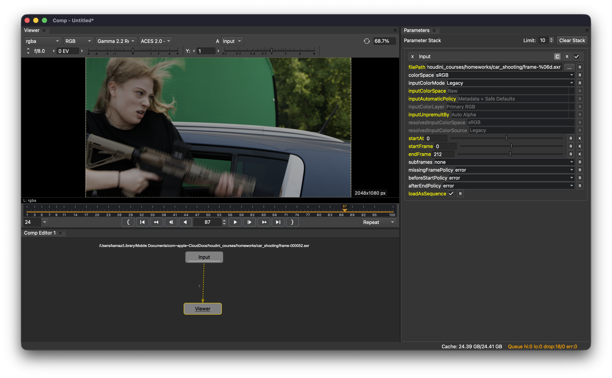
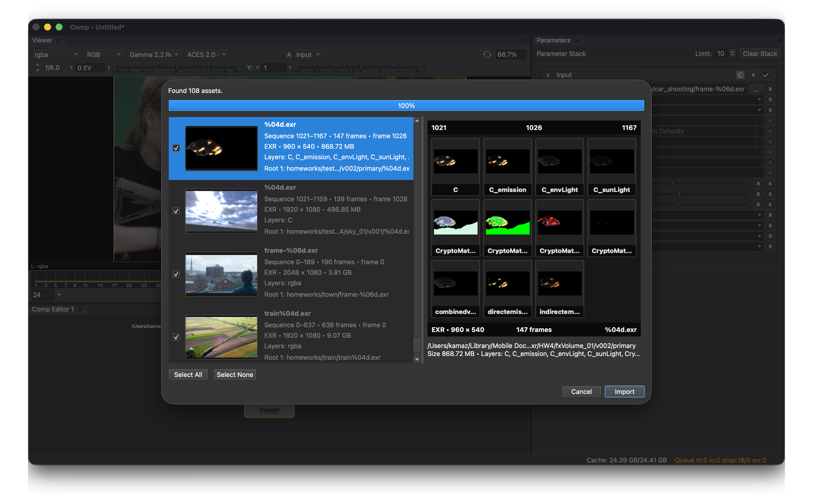

# Comp releases

Welcome to the release page for **Comp**. Thank you for your interest.

> [!WARNING]
> Comp is currently available as an early public alpha for evaluation and testing. Please keep backups of important files and use the application at your own discretion.

If you would like to try the project and help shape its future direction, I would be very grateful for your feedback.

I have been working on **Comp** for more than a year and a half. This release started as a simple personal side project, but after seeing some interest from the VFX community, I decided to package it into a more coherent form so that anyone interested can test it and share feedback.

Your feedback will help define the direction of future development, as well as the pace at which the project can move forward.

## A quick look

<p align="center">
  <a href="./screenshots/comp-main-interface.png">
    
  </a>
  <a href="./screenshots/comp-import-images.png">
    
  </a>
</p>

## Community and Support

- LinkedIn: https://www.linkedin.com/in/yuri-radaev
- Buy Me a Coffee: https://buymeacoffee.com/yuri.r
- Discord: https://discord.gg/caJSDWwXX

## Downloads

The current public alpha is **Comp 0.1.2**, released on August 2, 2026.

### Comp application

| Platform | Recommended download | Alternative package | SHA-256 checksums |
|---|---|---|---|
| Windows x64 | [Comp 0.1.2 — ZIP, 51.9 MB](https://github.com/ukmsz/Comp-releases/releases/download/comp-0.1.2-alpha/comp-0.1.2-windows-alpha-rev-f42e324.zip) | — | [Windows checksums](https://github.com/ukmsz/Comp-releases/releases/download/comp-0.1.2-alpha/comp-0.1.2-windows-alpha-rev-f42e324.sha256) |
| macOS arm64 | [Comp 0.1.2 — DMG, 78.5 MB](https://github.com/ukmsz/Comp-releases/releases/download/comp-0.1.2-alpha/comp-0.1.2-macos-alpha-rev-f42e324.dmg) | [ZIP, 68.8 MB](https://github.com/ukmsz/Comp-releases/releases/download/comp-0.1.2-alpha/comp-0.1.2-macos-alpha-rev-f42e324.zip) | [macOS checksums](https://github.com/ukmsz/Comp-releases/releases/download/comp-0.1.2-alpha/comp-0.1.2-macos-alpha-rev-f42e324.sha256) |
| Linux | [Comp 0.1.2 — AppImage, 76.8 MB](https://github.com/ukmsz/Comp-releases/releases/download/comp-0.1.2-alpha/comp-0.1.2-linux-alpha-rev-f42e324.AppImage) | [tar.gz, 83.2 MB](https://github.com/ukmsz/Comp-releases/releases/download/comp-0.1.2-alpha/comp-0.1.2-linux-alpha-rev-f42e324.tar.gz) | [Linux checksums](https://github.com/ukmsz/Comp-releases/releases/download/comp-0.1.2-alpha/comp-0.1.2-linux-alpha-rev-f42e324.sha256) |

- **Windows:** extract the ZIP before running Comp. The current build is unsigned, so Windows may display a security warning. Verify the downloaded file using the published checksum before allowing it to run.
- **macOS:** the DMG is recommended for normal installation. The ZIP is provided as an alternative package.
- **Linux:** the AppImage is recommended for most users. The `tar.gz` archive is provided as an alternative package.
- **AI features:** Comp itself does not require the AI Worker. Download the Worker only if you specifically want to test the AI modules described below.

[View the Comp 0.1.2 release page](https://github.com/ukmsz/Comp-releases/releases/tag/comp-0.1.2-alpha)

[View all releases](https://github.com/ukmsz/Comp-releases/releases)

## Optional: Comp AI Worker Service

Comp can be used as a standalone compositor. You do not need the AI Worker for standard compositing operations.

The Comp AI Worker Service is a separate command-line component used by the optional AI modules currently available in Comp:

- **SAM3** — rough image segmentation;
- **MatAnyone2** — mask-edge refinement.

For the simplest setup, run Comp and the Worker on the same machine. The Worker can also accept requests over a local network, but transferring image frames between machines may add significant overhead.

### Worker downloads

The current Worker release is **v0.1.2**.

| Platform | Recommended download | Alternative package | SHA-256 checksums |
|---|---|---|---|
| Windows, CPU/CUDA | [Worker v0.1.2 — ZIP, 1.71 GB](https://github.com/ukmsz/Comp-releases/releases/download/worker-v0.1.2/Worker-Windows-CPU-CUDA-local-20260731-1520.zip) | — | [Windows checksums](https://github.com/ukmsz/Comp-releases/releases/download/worker-v0.1.2/Worker-Windows-SHA256SUMS.txt) |
| macOS, CPU/MPS | [Worker v0.1.2 — DMG, 47.8 MB](https://github.com/ukmsz/Comp-releases/releases/download/worker-v0.1.2/Worker-macOS-20260802-1712.dmg) | [ZIP, 39.9 MB](https://github.com/ukmsz/Comp-releases/releases/download/worker-v0.1.2/Worker-macOS-20260802-1712.zip) | [macOS checksums](https://github.com/ukmsz/Comp-releases/releases/download/worker-v0.1.2/Worker-macOS-SHA256SUMS.txt) |

[View the Worker v0.1.2 release page](https://github.com/ukmsz/Comp-releases/releases/tag/worker-v0.1.2)
> [!IMPORTANT]
> Neural-network model weights are not included in the Worker packages.
> Download the required files separately and place them in the folders shown
> below.


### Required model files

| Module | Download | Destination | Final filename |
|---|---|---|---|
| MatAnyone2 | [Download `mat2_bundle.pt`](https://huggingface.co/kamaz01/MatAnyone2/resolve/main/mat2_bundle.pt?download=true) | `<worker-installation-root>/family_bundles/mat2/models/` | `mat2_bundle.pt` |
| SAM3 tokenizer | [Download `bpe_simple_vocab_16e6.txt.gz`](https://huggingface.co/kamaz01/CompAutoMatte_sam3/resolve/main/bpe_simple_vocab_16e6.txt.gz?download=true) | `<worker-installation-root>/family_bundles/sam3/assets/` | `bpe_simple_vocab_16e6.txt.gz` |
| SAM3.1 model | [Download `sam3_bundle.pt`](https://huggingface.co/kamaz01/CompAutoMatte_sam3/resolve/main/sam3_bundle.pt?download=true) | `<worker-installation-root>/family_bundles/sam3/models/` | `sam3_bundle.pt` |

The resulting directory structure should look like this:

```text
<worker-installation-root>/
└── family_bundles/
    ├── mat2/
    │   └── models/
    │       └── mat2_bundle.pt
    └── sam3/
        ├── assets/
        │   └── bpe_simple_vocab_16e6.txt.gz
        └── models/
            └── sam3_bundle.pt
```

If Hugging Face asks you to sign in, request access, or accept model repository
conditions, complete that step before downloading the file.

Third-party model files have their own licenses and access conditions. Review
those conditions before downloading or using the models.


### Starting the Worker

Replace the placeholder paths and `TARGET` in the following example:

```text
"<path-to-worker-executable>" serve \
  --family-bundle "mat2=<worker-installation-root>/family_bundles/mat2" \
  --family-bundle "sam3=<worker-installation-root>/family_bundles/sam3" \
  --target TARGET \
  --bind-host 127.0.0.1 \
  --port 19282 \
  --temp-dir "<path-to-temp-directory>/comp-worker" \
  --cpu-threads 0 \
  --precision fp32 \
  --verbose
```

Use one of the following target values:

- `cuda` — NVIDIA GPU;
- `mps` — Apple GPU on macOS;
- `cpu` — CPU processing.

The example uses `127.0.0.1`, which makes the Worker accessible only from the
same machine.

For a reduced-memory test, add:

```text
--max-propagation-history-depth 2
--max-mem-frames 2
```

The command above uses Unix-style line continuation. In PowerShell, either put
the command on one line or replace each trailing `\` with a PowerShell
backtick.

## Supported platforms

Comp currently provides packaged builds for:

- **Windows x64**
- **macOS arm64** — Apple Silicon
- **Linux x86_64**

The Linux build is packaged and tested on **Rocky Linux 10.2**, which currently serves as the baseline Linux environment. It may also work on other recent x86_64 Linux distributions, but they have not yet been tested systematically. Compatibility with older distributions is not guaranteed.

Development is still done primarily on macOS. Windows and Linux builds are produced and tested on native systems, but testing coverage is currently limited, so platform-specific bug reports are especially helpful.

## GPU rendering

At the moment, **Comp** does not use GPU acceleration for compositing operations. Only image drawing in the viewer is accelerated.

I have not yet chosen the backend for GPU compositing. The cross-platform **Qt RHI** looks like the simplest solution, but it would introduce Qt dependencies into the headless renderer.

One possible option would be to simply not support GPU acceleration in headless mode, but this is still open for discussion.

A more hardcore option would be to write three separate implementations for Metal, Vulkan and CUDA, this would provide speed, flexibility, and fewer limitations. However, before doing that, the current feature set needs to be stabilized so that rendering is predictable and can be used as a reference for comparison with the GPU implementation.

## Approximate roadmap for Comp

- Release the first alpha version.
- Collect feedback and fix bugs.
- Release the second alpha version.
- If no critical bugs are found, freeze this version as the reference for the Linux port.
- Hold a vote and choose a Linux distribution for development and testing.
- Release the second alpha version for Linux.
- Fix bugs and freeze that version as the reference.
- Develop and integrate GPU rendering identical to CPU rendering.
- Release the third alpha version.

## Approximate roadmap for AI Worker Service

- Finish implementing two new modules:
  - Corridor Crew keyer
  - DVD depth estimator

## Related projects, papers, and dependencies

- [MatAnyone2][matanyone2-github] ([project page][matanyone2-page])
- [Facebook/SAM3][sam3-github] ([Meta research page][sam3-meta], [SAM3.1 model weights][sam31-hf])
- [OpenCV][opencv-home] ([GitHub][opencv-github])
- [V-BM3D / VBM3D paper][vbm3d-paper]
- [VBM3D implementation paper][vbm3d-ipol]
- [JSON][json-org] ([ECMA-404][json-ecma404])
- [libtorch / PyTorch C++ API][libtorch-cpp]
- [C++17 / ISO/IEC 14882:2017][cpp17-iso] ([cppreference C++17 overview][cpp17-cppreference])
- [Qt RHI][qt-rhi]
- [Qt Advanced Docking System — ADS][qt-ads]
- [nlohmann/json][nlohmann-json]
- [ExprTk][exprtk]
- [Tcl/Tk][tcltk]
- [OpenEXR][openexr] / [Imath][imath]
- [OpenMP][openmp]

[matanyone2-github]: https://github.com/pq-yang/MatAnyone2
[matanyone2-page]: https://pq-yang.github.io/projects/MatAnyone2/
[sam3-github]: https://github.com/facebookresearch/sam3
[sam3-meta]: https://ai.meta.com/research/sam3/
[sam31-hf]: https://huggingface.co/facebook/sam3.1
[opencv-home]: https://opencv.org/
[opencv-github]: https://github.com/opencv/opencv
[vbm3d-paper]: https://www.eurasip.org/Proceedings/Eusipco/Eusipco2007/Papers/A1L-G03.pdf
[vbm3d-ipol]: https://arxiv.org/abs/2001.01802
[json-org]: https://json.org/
[json-ecma404]: https://ecma-international.org/publications-and-standards/standards/ecma-404/
[libtorch-cpp]: https://docs.pytorch.org/cppdocs/
[cpp17-iso]: https://www.iso.org/standard/68564.html
[cpp17-cppreference]: https://cppreference.com/cpp/17
[qt-rhi]: https://doc.qt.io/qt-6/topics-graphics.html
[qt-ads]: https://github.com/githubuser0xFFFF/Qt-Advanced-Docking-System
[nlohmann-json]: https://github.com/nlohmann/json
[exprtk]: https://www.partow.net/programming/exprtk/index.html
[tcltk]: https://www.tcl-lang.org/
[openexr]: https://github.com/AcademySoftwareFoundation/openexr
[imath]: https://github.com/AcademySoftwareFoundation/Imath
[openmp]: https://www.openmp.org/specifications/


