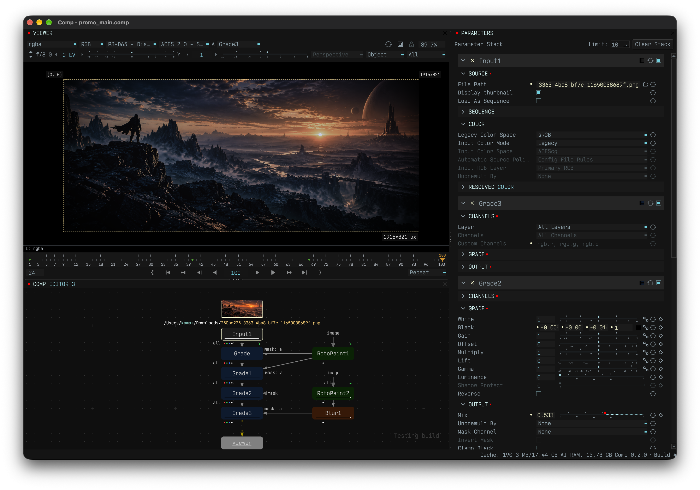
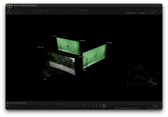
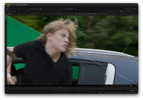
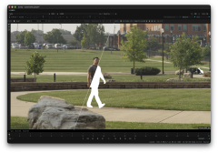
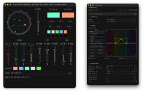
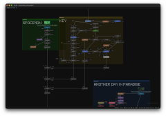
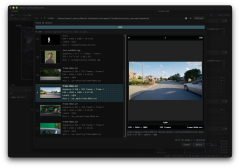

# Comp

Independent node-based compositing software for everyone.

Key, roto, paint, track and build 3D projections on Windows, macOS and Linux.

[Downloads](#downloads) · [Features](#comp-02-features) · [AI setup](#ai-setup) · [Community](#community-and-support)

Current release: **Comp 0.2.0 beta**.



## Comp 0.2 features

Comp has 63 built-in nodes. The update adds 3D projections, local AI, new keying and image tools, and a redesigned interface.

- **Workspace and sources.** Organize graphs with named, colored backdrops, Input thumbnails and routing Dots. Input opens the content browser by default, with sequence previews and AOV inspection. Compare different nodes in multiple Viewers and save workspace layouts.
- **Keying and edge treatment.** Combine color samples with MultiKeyer, remove spill with Despill, apDespill or CCdespill, and recover foreground color with EdgeReconstruct. BlendSpill uses the final background to treat edges. CCkey adds local AI green-screen keying.
- **RotoPaint.** Animate splines, adjust feathering, and paint or clone in the Viewer. RGB Motion Tracking stores motion in separate Motion Takes, so hand-animated shape keys remain editable. Mute, retrack, adjust strength or bake the motion into keys.
- **Tracking, lenses and warps.** Track points or planar surfaces for stabilization and matchmove, and export CornerPin animation. LensDistortion includes nine 3DE models and imports supported 3DE Nuke-format lens exports, including animated coefficients. GridWarp, STmap and iDistort provide other warp tools.
- **Color and channels.** Work in 32-bit float with layered EXRs, AOVs and OpenColorIO. Grade and HueCorrect provide color correction; HueCorrect uses hue-based curves for color, luminance and spill adjustment. Shuffle, ChannelMerge and ChannelModify route and edit channels.
- **Color Picker.** Choose colors with an HSV wheel or CIE u′v′ diagram and gamut overlays. Edit HDR working-space RGBA, temperature, magenta/green balance and intensity. Sample original Viewer pixels or regions, save colors and copy full-precision values.
- **Local AI.** AutoMatte uses SAM3 for subject selection and MatAnyone2 for temporal matte refinement. Both can run inside Comp or through an external Worker. CCkey runs locally. Compatible model bundles are supplied separately.
- **3D projections and rendering.** Import FBX or Alembic camera animation and project images onto cards. 3D Renderer preserves source layers and adds depth plus per-object UV, motion-vector and alpha passes. It supports camera and card motion blur, overscan and Crop to Format.
- **Filters and motion.** Generate optical-flow vectors with MotionVector and use them in VectorBlur. Defocus supports depth maps and a Varying Kernel for elliptical or swirling bokeh. Other filters include DirectionalBlur, EdgeBlur, Glow, GodRays and temporal Denoise.
- **Animation and expressions.** Edit parameter curves and fractional-frame keys. Drive values with expressions that use frame context, composition settings or references to other parameters. Comp supports a defined subset of ExprTK and Tcl functions and commands, rather than the full languages.
- **Smart cache.** Reuse unchanged node results when revisiting frames or adjusting downstream controls. Lossless cache compression fits more frames within the memory budget without changing pixels.

## Screenshots

Select a preview to open the full-size screenshot.

| 3D projections | Keying and edge treatment |
| :---: | :---: |
| [](./screenshots/comp-3d-projections.webp) | [](./screenshots/comp-keying.webp) |
| **AutoMatte** | **[Color Picker](./screenshots/comp-color-picker.webp) and [HueCorrect](./screenshots/comp-huecorrect.webp)** |
| [](./screenshots/comp-automatte.webp) | [](./screenshots/comp-color-tools.webp) |
| **Graph editor and backdrops** | **Content browser** |
| [](./screenshots/comp-node-graph.webp) | [](./screenshots/comp-content-browser.webp) |

## Downloads

**Comp 0.2.0 beta** · Released November 6, 2026 · Free to use

| Platform | Download | Alternative | SHA-256 |
| --- | --- | --- | --- |
| Windows x64 | [ZIP · 1.89 GB](https://github.com/ukmsz/Comp-releases/releases/download/comp-0.2.0-beta/comp-0.2.0-windows-beta-rev-7dab684.zip) | — | [Checksums](https://github.com/ukmsz/Comp-releases/releases/download/comp-0.2.0-beta/comp-0.2.0-windows-beta-rev-7dab684.sha256) |
| macOS Apple Silicon | [DMG · 96.3 MB](https://github.com/ukmsz/Comp-releases/releases/download/comp-0.2.0-beta/comp-0.2.0-macos-beta-rev-7dab684.dmg) | [ZIP · 82.5 MB](https://github.com/ukmsz/Comp-releases/releases/download/comp-0.2.0-beta/comp-0.2.0-macos-beta-rev-7dab684.zip) | [Checksums](https://github.com/ukmsz/Comp-releases/releases/download/comp-0.2.0-beta/comp-0.2.0-macos-beta-rev-7dab684.sha256) |
| Linux x86-64-v2 | [AppImage · 2.06 GB](https://github.com/ukmsz/Comp-releases/releases/download/comp-0.2.0-beta/comp-0.2.0-linux-beta-rev-7dab684.AppImage) | [tar.xz · 1.97 GB](https://github.com/ukmsz/Comp-releases/releases/download/comp-0.2.0-beta/comp-0.2.0-linux-beta-rev-7dab684.tar.xz) | [Checksums](https://github.com/ukmsz/Comp-releases/releases/download/comp-0.2.0-beta/comp-0.2.0-linux-beta-rev-7dab684.sha256) |

- **Windows:** extract the ZIP before running Comp.
- **macOS:** open the DMG for installation, or use the ZIP package.
- **Linux:** see the [Linux baseline](#linux-baseline) below.

See the [release notes](https://github.com/ukmsz/Comp-releases/releases/tag/comp-0.2.0-beta) for build details, or browse [all releases](https://github.com/ukmsz/Comp-releases/releases).

Current releases are free. A paid advanced version is planned.

### Linux baseline

| Requirement | Baseline |
| --- | --- |
| CPU | 64-bit Intel/AMD, **x86-64-v2** |
| glibc | **2.34+** |
| C++ runtime | `GLIBCXX_3.4.29`, `CXXABI_1.3.13` |
| Target distributions | **Ubuntu 22.04+**, **Debian 12+**, **Rocky/AlmaLinux 9+** |

## AI setup

### Local AI in Comp 0.2

The 0.2 build includes the local runtime.

[Download the AI model bundle (ZIP)](https://huggingface.co/buckets/kamaz01/comp_bundles/resolve/comp_ai_bundles.zip). The same archive supports local AI in Comp 0.2 and AI Worker 0.1.2.

1. Extract `comp_ai_bundles.zip`, keeping each model folder's manifest and required assets together.
2. Select the extracted `sam3` and `mat2` folders in **Local AI settings** for the models you want to use.
3. Enable the models and save. Resolve any initialization error before using them.
4. For CCkey, choose a `1024` or `2048` folder inside `cckey_resolutions_mps` on macOS or `cckey_resolutions_cuda` on Windows or Linux. Match the folder to the inference resolution. The output keeps the source dimensions.

Local AI uses Apple Metal (MPS) on macOS and NVIDIA CUDA on Windows or Linux. AutoMatte can use an external Worker when its local model is disabled. If an enabled local model fails, Comp reports the error rather than switching to the Worker. CCkey runs locally only.

### Optional AI Worker 0.1.2

Worker 0.1.2 runs SAM3 and MatAnyone2 in a separate process for AutoMatte. Run it on the same computer or another machine; remote processing includes frame-transfer time. Standard compositing and local AI do not need the Worker.

| Platform | Download | Alternative | SHA-256 |
| --- | --- | --- | --- |
| Windows, CPU/CUDA | [ZIP](https://github.com/ukmsz/Comp-releases/releases/download/worker-v0.1.2/Worker-Windows-CPU-CUDA-local-20260731-1520.zip) | — | [Checksums](https://github.com/ukmsz/Comp-releases/releases/download/worker-v0.1.2/Worker-Windows-SHA256SUMS.txt) |
| macOS, CPU/MPS | [DMG](https://github.com/ukmsz/Comp-releases/releases/download/worker-v0.1.2/Worker-macOS-20260802-1712.dmg) | [ZIP](https://github.com/ukmsz/Comp-releases/releases/download/worker-v0.1.2/Worker-macOS-20260802-1712.zip) | [Checksums](https://github.com/ukmsz/Comp-releases/releases/download/worker-v0.1.2/Worker-macOS-SHA256SUMS.txt) |

[Worker v0.1.2 release notes](https://github.com/ukmsz/Comp-releases/releases/tag/worker-v0.1.2)

Model weights are not included in the Worker packages. [Download the model bundle](https://huggingface.co/buckets/kamaz01/comp_bundles/resolve/comp_ai_bundles.zip) and extract it. Worker 0.1.2 uses its `mat2` and `sam3` folders; the CCkey folders are for Comp 0.2.

Keep these folders and files together:

```text
<models-folder>/
└── comp_ai_bundles/
    ├── mat2/
    │   ├── bundle_manifest.txt
    │   └── models/
    │       └── mat2_bundle.pt
    └── sam3/
        ├── bundle_manifest.txt
        ├── assets/
        │   └── bpe_simple_vocab_16e6.txt.gz
        └── models/
            └── sam3_bundle.pt
```

Replace the placeholder paths and `TARGET`:

```text
"<path-to-worker-executable>" serve \
  --family-bundle "mat2=<models-folder>/comp_ai_bundles/mat2" \
  --family-bundle "sam3=<models-folder>/comp_ai_bundles/sam3" \
  --target TARGET \
  --bind-host 127.0.0.1 \
  --port 19282 \
  --temp-dir "<path-to-temp-directory>/comp-worker" \
  --cpu-threads 0 \
  --precision fp32 \
  --verbose
```

Use `cuda` for an NVIDIA GPU, `mps` for an Apple GPU on macOS, or `cpu` for CPU processing. `127.0.0.1` limits connections to the same computer. Enter the Worker's address in Comp's Worker settings.

To reduce memory use, add:

```text
--max-propagation-history-depth 2
--max-mem-frames 2
```

The command uses Unix-style line continuation. In PowerShell, put it on one line or replace each trailing `\` with a PowerShell backtick.

Follow each model's access and license terms. Hugging Face may require sign-in or acceptance of repository conditions before downloading.

## Current limits

- Compositing nodes run on the CPU. Viewer display is GPU-accelerated; AI processing has its own GPU runtime.
- General Nuke project and gizmo import is not supported. Lens import accepts supported 3DE Nuke-format exports.
- OFX plugins are not supported.
- 3D scenes contain cameras and cards. Camera import supports perspective cameras; Alembic import uses Ogawa.
- Animated raster-to-shape conversion in RotoPaint is experimental.

## Community and support

For bug reports, include your Comp build, operating system and steps to reproduce the issue.

- [Discord](https://discord.gg/9vgz4Xv655) — questions, workflows and bug reports.
- [LinkedIn](https://www.linkedin.com/in/yuri-radaev) — project updates from Yuri Radaev.
- [Support development](https://buymeacoffee.com/yuri.r) — help fund work on Comp.

## License and credits

Comp uses a proprietary license. See [COMP-LICENSE.txt](COMP-LICENSE.txt) and [THIRD-PARTY-NOTICES.txt](THIRD-PARTY-NOTICES.txt) for the application terms and dependency notices.

**CCkey is based on [Corridor Crew Keyer 1](https://github.com/nikopueringer/CorridorKey).** AutoMatte uses [SAM3](https://github.com/facebookresearch/sam3) and [MatAnyone2](https://github.com/pq-yang/MatAnyone2). AI models have separate licenses and access conditions.

### Related projects, papers and dependencies

- [MatAnyone2](https://github.com/pq-yang/MatAnyone2) ([project page](https://pq-yang.github.io/projects/MatAnyone2/))
- [SAM3](https://github.com/facebookresearch/sam3) ([Meta research page](https://ai.meta.com/research/sam3/), [SAM3.1 model weights](https://huggingface.co/facebook/sam3.1))
- [OpenCV](https://opencv.org/) ([GitHub](https://github.com/opencv/opencv))
- [V-BM3D / VBM3D paper](https://www.eurasip.org/Proceedings/Eusipco/Eusipco2007/Papers/A1L-G03.pdf)
- [VBM3D implementation paper](https://arxiv.org/abs/2001.01802)
- [JSON](https://json.org/) ([ECMA-404](https://ecma-international.org/publications-and-standards/standards/ecma-404/))
- [libtorch / PyTorch C++ API](https://docs.pytorch.org/cppdocs/)
- [C++17 / ISO/IEC 14882:2017](https://www.iso.org/standard/68564.html) ([cppreference](https://cppreference.com/cpp/17))
- [Qt RHI](https://doc.qt.io/qt-6/topics-graphics.html)
- [Qt Advanced Docking System](https://github.com/githubuser0xFFFF/Qt-Advanced-Docking-System)
- [nlohmann/json](https://github.com/nlohmann/json)
- [ExprTk](https://www.partow.net/programming/exprtk/index.html)
- [Tcl/Tk](https://www.tcl-lang.org/)
- [OpenEXR](https://github.com/AcademySoftwareFoundation/openexr) / [Imath](https://github.com/AcademySoftwareFoundation/Imath)
- [OpenMP](https://www.openmp.org/specifications/)
